# Moving Day Chaos 🛋️📦

> **الحالة: الإصدار 0.1.0 قابل للعب، والإصدار 0.2.0 (إعادة تصميم الشكل كامل) بدأ — شوف [`docs/RELEASE_0.2.0.md`](docs/RELEASE_0.2.0.md).**
> الموجود الحين: 11 مهمة مرتبة بالصعوبة وتنفتح بالنجوم، لعب فردي أو جماعي (شبكة محلية أو عبر الإنترنت بكود غرفة)،
> رصيد للشركة ومتجر ترقيات، 4 شخصيات، موسيقى، عربي/إنجليزي، ونسخ أندرويد وويندوز وماك (وآيفون يدوي) تنرفع على itch.io.
> **Status: v0.1.0 playable** (11 jobs, LAN + internet co-op, company bank + upgrade shop, Android/Windows/macOS builds on itch.io).
> **Next: v0.2.0 — full visual redesign** (environment, props, characters, movement). See `docs/RELEASE_0.2.0.md`.

## الفكرة باختصار
لعبة جماعية فوضوية بفيزياء مضحكة لـ 1–4 لاعبين أونلاين على Steam: أنت وأصحابك عمّال شركة نقل عفش، لازم تنقلون أثاث بيت كامل للشاحنة قبل ما يخلص الوقت… والكنبة ما تبغى تطلع من الباب، والتلفزيون على وشك يطيح.

A 1–4 player online co-op physics party game: you and your friends are movers who must get a whole
home's furniture into the truck before time runs out — through narrow stairs, tight doors and your
friends' "help".

| | |
|---|---|
| **التصنيف / Genre** | Co-op physics party · Simulation · Comedy |
| **المنصة / Platform** | Steam (Windows, Steam Deck) — later consoles via publisher |
| **اللاعبين / Players** | 1–4 online (Steam lobbies) + Steam Remote Play Together |
| **المحرك / Engine** | Godot 4.7 + GodotSteam |
| **الستايل / Style** | Stylized low-poly 3D, bright colors, third-person |
| **السعر / Price** | $5.99 + 4-pack "Moving Crew" bundle |
| **مدة التطوير / Scope** | MVP ~8–10 weeks, Early Access ~4–6 months |

## جرّب اللعبة / Play the game
افتح المجلد في Godot 4.7 واضغط Play (أو `godot --path .`).

| التحكم | Keyboard + mouse | Gamepad |
|---|---|---|
| حركة / Move | WASD | Left stick |
| توجيه الأيدي والكاميرا / Aim arms + camera (انظر لتحت عشان توصل للأرض) | Mouse | Right stick |
| مسك يد يسرى / يمنى — Grab left / right (hold) | LMB / RMB | LT / RT |
| مسك بالاثنتين / Grab both | F | — |
| لف القطعة / Spin held item | Q / E | LB / RB |
| قفز / Jump | Space | A |
| إيقاف / Pause | Esc | Start |

**📱 Android / 💻 Windows / 🍎 Mac:** كل push على `main` يبني النسخ تلقائياً (GitHub Actions ← *Android build*)
ويرفعها على itch.io، والـ APK كمان في [Releases → android-latest](https://github.com/karmontal/moving-day-chaos/releases/tag/android-latest).
نسخة الآيفون تنبني يدوياً من workflow *iOS*.
افتح الرابط من الجوال، نزّل `moving-day-chaos.apk` وثبّته (اسمح بالتثبيت من مصادر غير معروفة).
التحكم باللمس: اليسار للحركة، اسحب في اليمين لتنظر وترفع/تنزل الأيدي، وأزرار **امسك / يسرى / يمنى** تشتغل بالضغط مرة للمسك ومرة للإفلات.
> النسخة موقّعة بمفتاح تجريبي (`tools/android/debug.keystore`). قبل Google Play لازم مفتاح رفع خاص يُحفظ في Secrets.

**👥 أونلاين:** من القائمة ← **العب أونلاين** ← واحد يفتح غرفة والباقي يشوفونها تلقائياً
لو على نفس الواي فاي (أو يدخلوا بالـ IP اللي يظهر عند المضيف). كل لاعب يختار شخصية (ما تتكرر)، والمضيف يبدأ.
المضيف يشغّل الفيزياء كلها ويبعث لقطات ~30 مرة بالثانية؛ الباقي يبعثون حركتهم فقط. شغّال بين الكمبيوتر والأندرويد.
**🌍 عبر الإنترنت (بكود الغرفة):** "افتح غرفة أونلاين" يعطيك كود من 6 حروف، وصاحبك يكتبه من أي مكان.
الاتصال يمر عبر سيرفر [noray](https://github.com/foxssake/noray) على الـ VPS: يحاول اتصال مباشر أولاً، ولو ما زبط يمرّر عبره.
تركيب السيرفر: `tools/server/setup_noray.sh` (Ubuntu، مرة وحدة)، وعنوانه في `data/online.json`.
اختبار آلي: `tools/net_test.sh <godot> [lan|nat|relay]` يشغّل مضيف ولاعب ويتأكد إن الحركة توصل للطرفين.

- كل يد لها قوة محدودة: الكنبة (70 كغ) تحتاج **لاعبين**؛ لما تلعب لوحدك يديك أقوى ×1.75 (`data/game.json` → `solo_strength`).
- القطع الهشة (التلفزيون، الأباجورة، النبتة) تنكسر من أول ضربة قوية؛ الكراتين والكراسي "تنبعج" وتقل قيمتها.
- القطعة تنحسب محمّلة لما تستقر داخل الشاحنة (المنطقة الصفراء). الكنبة ما تطلع من الباب الأمامي إلا إذا لفّيتها.

| | |
|---|---|
| 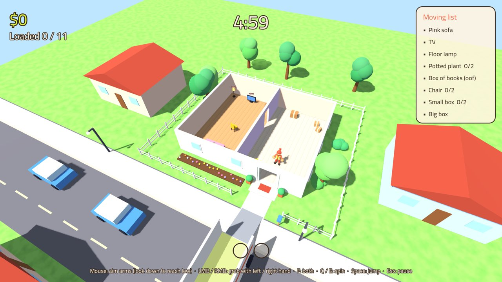 | 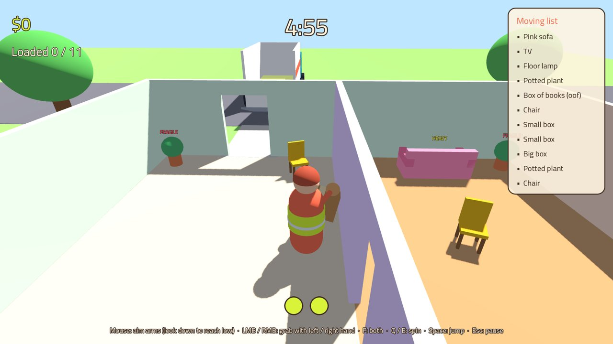 |
| 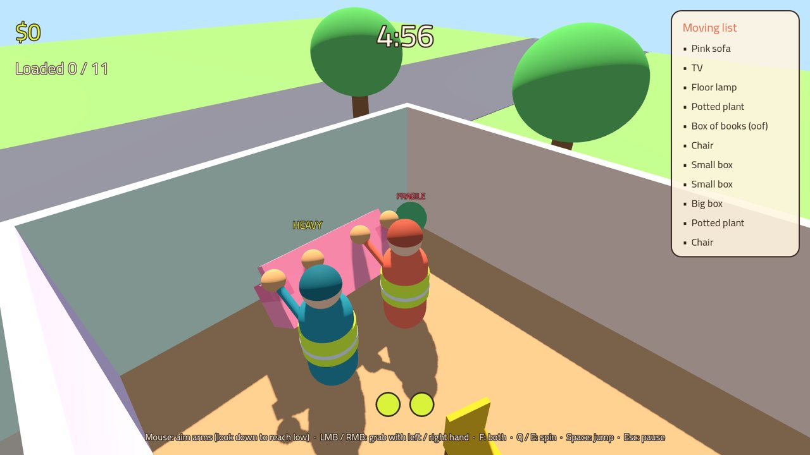 | 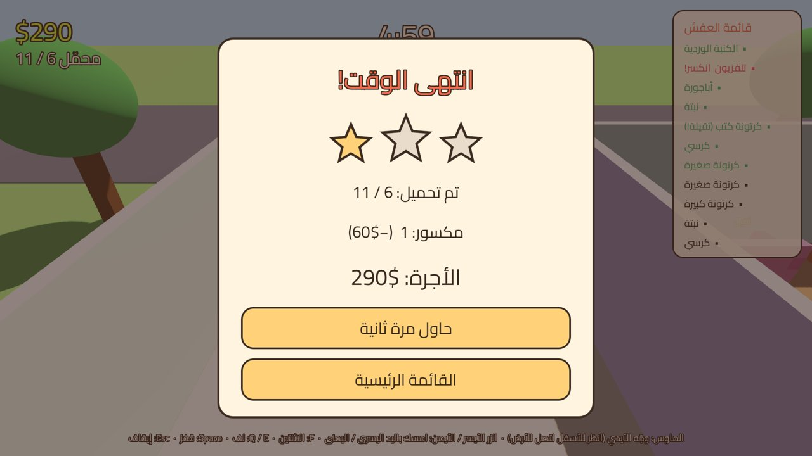 |
| 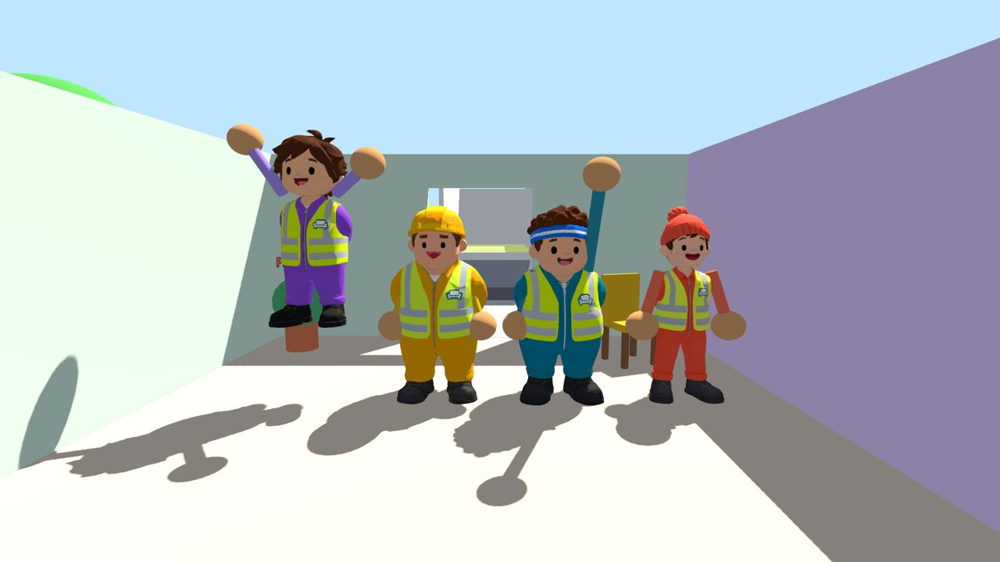 | 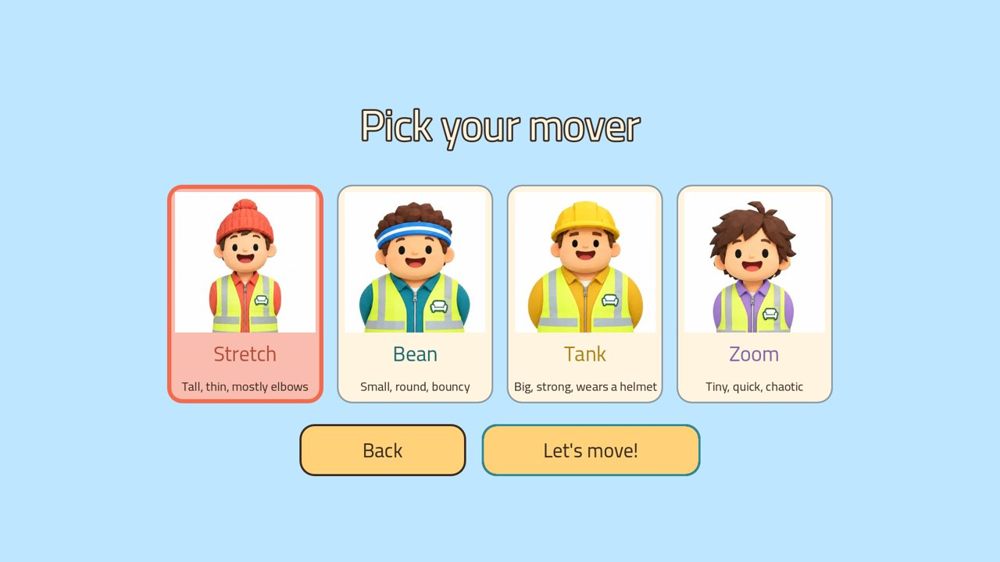 |
| 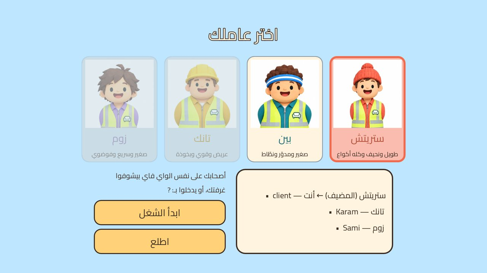 | |

**الاختبارات / Tests:** `godot --headless --path . res://tests/test_runner.tscn`
**الصور / Screenshots:** `xvfb-run -s "-screen 0 1920x1080x24" godot --path . --rendering-driver opengl3 res://tools/screenshot.tscn -- mission out.png`

## التوثيق / Documentation
| الملف | المحتوى |
|---|---|
| [`docs/GDD.md`](docs/GDD.md) | وثيقة تصميم اللعبة: الحلقة الأساسية، الميكانيكيات، المحتوى، التقدّم |
| [`docs/ART_DIRECTION.md`](docs/ART_DIRECTION.md) | الستايل البصري للإصدار 0.1 (بينتغير في 0.2.0) |
| [`docs/TECH_DESIGN.md`](docs/TECH_DESIGN.md) | Technical design: networking, physics sync, grab system, architecture, tests |
| [`docs/MARKET.md`](docs/MARKET.md) | السوق والمنافسين والتسعير وخطة الـ Wishlists |
| [`docs/ROADMAP.md`](docs/ROADMAP.md) | المراحل من النموذج الأولي إلى الإطلاق، والإصدارات |
| [`docs/RELEASE_0.2.0.md`](docs/RELEASE_0.2.0.md) | خطة الإصدار 0.2.0: إعادة تصميم البيئة والعفش والشخصيات والحركة |
| [`marketing/story/`](marketing/story) | قصة المقدمة (6 لوحات + فيديو) |
| [`marketing/store/`](marketing/store) | صور ونصوص صفحات Steam و itch.io |
| [`concept/`](concept) | الصور المبدئية (Higgsfield) مع وصف كل صورة |

## الصور المبدئية / Concept art
| | |
|---|---|
| 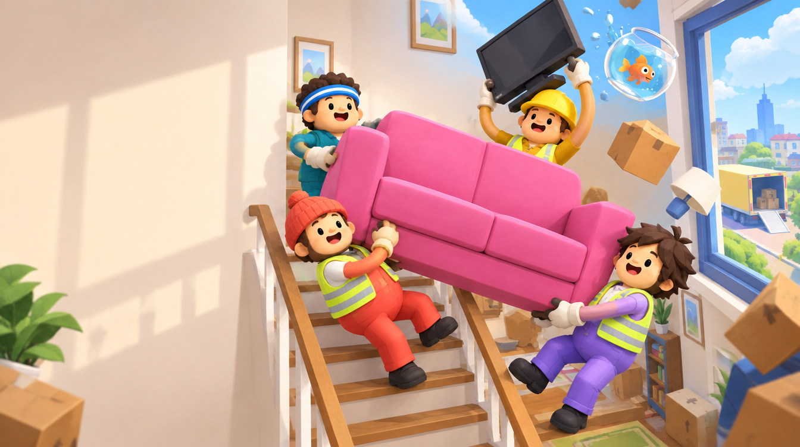 | 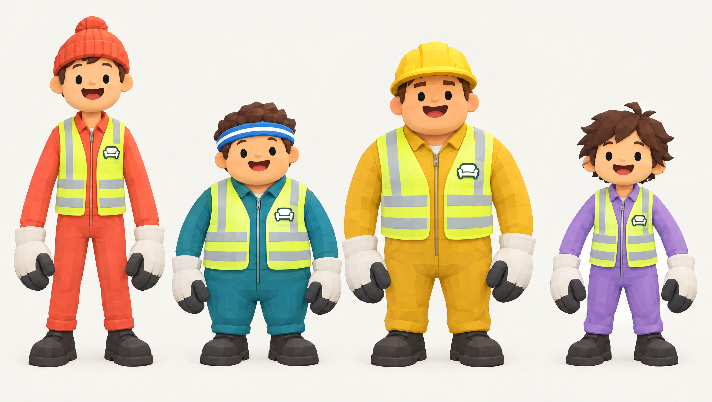 |
| 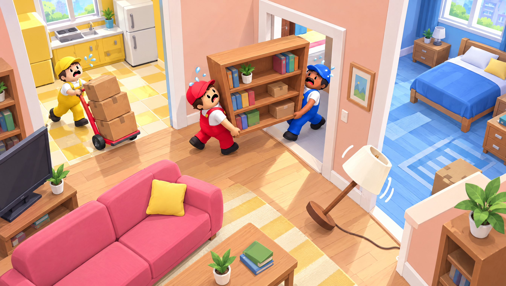 | 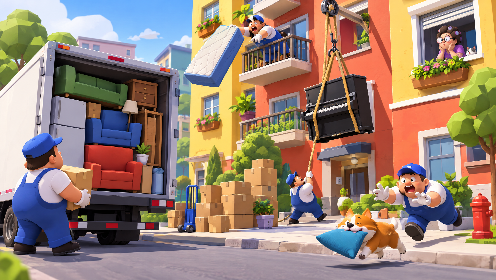 |

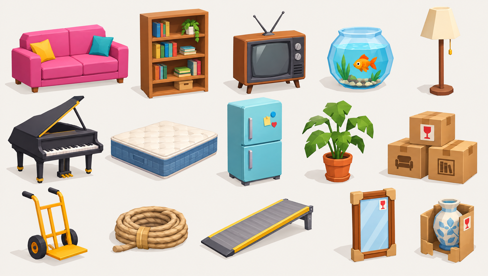
